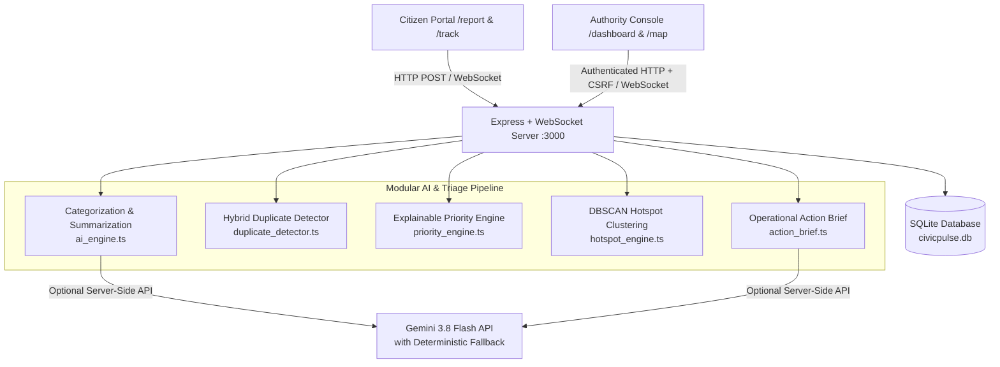

# CivicPulse AI — From Complaints to Action

> **Tagline:** *"Report Problems. Discover Patterns. Prioritize Action."*

CivicPulse AI is an end-to-end civic complaint management and municipal operations platform built for the AI for Civic Impact hackathon. It transforms unstructured citizen reports into categorized, summarized, deduplicated, geographically clustered, explainably prioritized, and real-time trackable municipal workflows.

---

## 1. Problem Statement

Municipal authorities receive hundreds of unstructured citizen reports daily regarding damaged roads, waterlogging, overflowing garbage bins, blocked drainage systems, broken streetlights, and public safety hazards (such as uncovered manholes or exposed live electrical wires).

Without intelligent triage:
- Critical life-safety hazards sit buried behind routine cosmetic complaints.
- Multiple citizens report the same incident, creating fragmented duplicate work orders.
- Interconnected neighborhood infrastructure failures (e.g., clogged drainage causing waterlogging and road craters) are treated as isolated tickets rather than geographic hotspots.
- Citizens lack transparent, chronological visibility into whether their complaint is under review, assigned, in progress, or resolved.

---

## 2. Solution Overview

CivicPulse AI implements a four-stage operational pipeline with real-time WebSocket synchronization:

1. **CAPTURE:** Anonymous-first citizen reporting with description validation, category selection, ward naming, interactive Leaflet map-pin coordinate selection (plus optional GPS-free submission), and validated image evidence upload.
2. **UNDERSTAND:** Modular AI and deterministic fallback pipeline performing automatic categorization (with confidence scores and `Needs Review` uncertainty flags), factual officer summarization, hybrid geographic + lexical duplicate candidate detection, and transparent weighted priority scoring (`0.35×Urgency + 0.35×SafetyImpact + 0.20×PeopleAffected + 0.10×Recurrence`).
3. **REVEAL:** Real-time Authority Dashboard, DBSCAN Geographic Hotspot clustering map, and automated Operational Action Briefs calculated directly from SQLite database records.
4. **ACT:** Protected administrative workflow (`Submitted → Under Review → Assigned → In Progress → Resolved / Reopened`) with `scrypt` password hashing, session validation, CSRF protection, non-destructive duplicate verification, and live citizen status tracking.

---

## 3. Main Features

- **Citizen Report Intake (`/report`):** Validates required fields, prevents accidental rapid double-clicks, supports interactive map-pin coordinate selection or unmapped reporting, validates optional JPEG/PNG/WebP image uploads, and generates a unique public tracking ID (`CP-2026-XXXXXX`).
- **Explainable Priority Engine:** Calculates a 0.00–5.00 score across Urgency, Safety Impact, People Affected, and Recurrence, disclosing every text-inferred estimate, missing coordinate notice, and life-safety escalation override.
- **Hybrid Duplicate Detection:** Ranks candidate duplicates using Haversine distance, category compatibility, and lexical-stem cosine similarity while preventing false positives across distant wards. Never deletes citizen records.
- **DBSCAN Geographic Hotspot Engine (`/map`):** Groups nearby geocoded complaints into spatial clusters (`HS-01`, `HS-02`, ...), identifies multi-category infrastructure stress zones, and distinguishes spatial clusters from confirmed single duplicates.
- **Real-Time Multi-User Synchronization (`/ws`):** Broadcasts `complaint:created`, `complaint:updated`, and `presence:update` events via WebSockets so all connected authority dashboards, maps, and citizen tracking pages update live.
- **Public Citizen Tracking (`/track`):** Displays current lifecycle progress, assigned municipal team, and chronological status history without exposing private citizen data or internal credentials.

---

## 4. Architecture Diagram



---

## 5. Technology Stack

- **Backend & Real-Time Server:** Node.js (TypeScript / `tsx`), Express 4, `ws` (WebSockets on port 3000), `crypto` (`scrypt` password hashing & CSRF token generation).
- **Database:** SQLite (`better-sqlite3` with WAL journaling, foreign keys, and indexed queries).
- **Frontend:** React 19, TypeScript, Tailwind CSS 4, Lucide Icons, semantic HTML5.
- **Mapping & Visualization:** Leaflet.js (`1.9.4`) with OpenStreetMap tiles (plus graceful offline coordinate canvas fallback and accessible list alternative), custom SVG/CSS database aggregate charts.
- **AI & Data Processing:** Server-side `@google/genai` (`gemini-3.8-flash`) with 4.5s timeout and automatic fallback to deterministic lexical rules (`deterministic-rule-fallback`), extractive summarization (`extractive-template-fallback`), Haversine + lexical-stem duplicate detection (`lexical-geo-hybrid-fallback`), weighted priority scoring, and spatial DBSCAN clustering.
- **Automated Testing:** Node.js `node:assert/strict` integration test runner (`tests/run_tests.ts`) running against an isolated temporary SQLite database.

---

## 6. Project Directory Structure

```text
/
├── server.ts                          # Express + WebSocket server & REST API routes
├── package.json                       # Dependencies and npm scripts (dev, build, start, seed, test)
├── index.html                         # HTML entry point with Plus Jakarta Sans, Public Sans, JetBrains Mono & Leaflet CSS
├── metadata.json                      # Application metadata
├── .env.example                       # Environment variable template
├── README.md                          # Complete setup, architecture, and API documentation
├── LIMITATIONS.md                     # Transparent disclosure of AI vs deterministic rules & limitations
├── DEMO.md                            # Reproducible 5-minute demonstration script
├── src/
│   ├── shared/
│   │   └── types.ts                   # Shared TypeScript interfaces and domain constants
│   ├── server/
│   │   ├── database.ts                # SQLite schema initialization, indexes, and scrypt hashing
│   │   ├── ai_engine.ts               # Categorization and summarization (Gemini + deterministic fallback)
│   │   ├── priority_engine.ts         # Explainable weighted priority scoring & boundary logic
│   │   ├── duplicate_detector.ts      # Haversine distance + lexical-stem duplicate detection
│   │   ├── hotspot_engine.ts          # Spatial DBSCAN geographic hotspot clustering
│   │   ├── action_brief.ts            # Operational action brief generator
│   │   ├── complaint_service.ts       # Transactional CRUD, workflow state machine, and analytics
│   │   └── seed_data.ts               # Idempotent 45-complaint synthetic dataset generator
│   ├── components/
│   │   ├── LandingView.tsx            # Overview landing page & live SQLite snapshot
│   │   ├── CitizenReportView.tsx      # Citizen report form, map pin picker & confirmation view
│   │   ├── CitizenTrackingView.tsx    # Public complaint tracker & chronological status timeline
│   │   ├── AuthorityDashboardView.tsx # Operations dashboard, KPIs, action brief, charts & filters
│   │   ├── ComplaintDetailView.tsx    # Detailed AI breakdown, duplicate review & officer console
│   │   ├── GeographicMapView.tsx      # Interactive Leaflet map, DBSCAN controls & hotspot sidebar
│   │   └── LeafletMapView.tsx         # Reusable Leaflet map components with tile error fallback
│   ├── App.tsx                        # Main application layout, routing, WebSocket client & auth modal
│   ├── main.tsx                       # React DOM mount
│   └── index.css                      # Tailwind CSS & typography rules
└── tests/
    └── run_tests.ts                   # 24 automated unit, API, security, and workflow tests
```

---

## 7. Prerequisites & Setup Instructions

### Environment Setup

1. Ensure **Node.js 20+** and **npm** are installed.
2. (Optional) If using a Python virtual environment alongside Node tooling:
   ```bash
   python3 -m venv .venv
   source .venv/bin/activate
   ```
3. Install project dependencies:
   ```bash
   npm install
   ```
4. Configure environment variables (copy `.env.example` to `.env` if customizing):
   ```bash
   cp .env.example .env
   ```
   Key variables in `.env`:
   - `GEMINI_API_KEY`: Optional Gemini API key for server-side LLM classification/summarization. Deterministic fallbacks run automatically if unset.
   - `ADMIN_USERNAME`: Defaults to `admin`
   - `ADMIN_PASSWORD`: Defaults to `civicpulse-admin-2026`
   - `DATABASE_PATH`: Defaults to `civicpulse.db`

### Database Initialization & Synthetic Data Loading

The SQLite database (`civicpulse.db`) initializes automatically on startup. To explicitly load or verify the 45-record synthetic dataset from the command line:

```bash
npm run seed
```
*(Re-running `npm run seed` is idempotent and will never duplicate existing seed records or overwrite citizen reports.)*

### Starting the Application

```bash
npm run dev
```
Open your browser at:
- **Local Address:** `http://localhost:3000`

### Administrative Login Instructions

To perform administrative actions (assigning teams, updating statuses, confirming/rejecting duplicates):
1. Click **Officer Sign-In** in the top workspace bar (or inside any Complaint Detail page).
2. Enter the default local demonstration credentials:
   - **Username:** `admin`
   - **Password:** `civicpulse-admin-2026`

### Running Automated Tests

```bash
npm test
```

---

## 8. AI Pipeline & Methodology

### A. Automatic Categorization & Summarization (`src/server/ai_engine.ts`)
- Normalizes complaint text and classifies into one of seven categories: `Road Damage`, `Waterlogging`, `Waste Management`, `Drainage`, `Streetlight`, `Public Safety`, or `Other`.
- Retains `citizen_category` separately from `predicted_category`.
- When `GEMINI_API_KEY` is configured, queries `gemini-3.8-flash` on the server with a 4.5-second timeout and structured JSON schema.
- When `GEMINI_API_KEY` is absent or unreachable, runs the weighted domain lexicon classifier (`deterministic-rule-fallback`) and sentence-level extractive summarizer (`extractive-template-fallback`).
- Flags complaints as `needs_review = true` when confidence `< 0.62`, when multiple competing categories are detected in the same description, or when citizen and predicted categories conflict.

### B. Explainable Priority Formula (`src/server/priority_engine.ts`)
Every complaint is scored using the transparent weighted formula:

$$\text{PriorityScore} = 0.35 \times \text{Urgency} + 0.35 \times \text{SafetyImpact} + 0.20 \times \text{PeopleAffected} + 0.10 \times \text{Recurrence}$$

Each factor is bounded in $[0.0, 5.0]$, yielding an overall score in $[0.00, 5.00]$ mapped to:
- **Low:** `0.00 – 1.49`
- **Medium:** `1.50 – 2.49`
- **High:** `2.50 – 3.49`
- **Critical:** `3.50 – 5.00`

Severe life-safety triggers (e.g., `open manhole`, `live wire`, `sparking transformer`, `collapsed wall`) activate an explicit `safety_override` escalation flag ensuring the complaint is surfaced at `Critical` (`>= 3.85`) with a clear explanation.

### C. Duplicate Detection (`src/server/duplicate_detector.ts`)
- Compares a new report against recent reports (excluding itself) using:
  1. **Category compatibility matrix** (e.g., `Drainage` and `Waterlogging` are compatible; incompatible categories are skipped).
  2. **Haversine geographic proximity** (reports with verified coordinates `> 850m` apart are strictly excluded to prevent false positives across different wards).
  3. **Lexical-stem cosine similarity** across normalized tokens and 5-character morphological stems.
- Returns ranked candidate objects with similarity score, distance in meters, and human-readable evidence. Officers can **Confirm** or **Reject** links without deleting citizen records.

### D. Geographic Hotspot Detection (`src/server/hotspot_engine.ts`)
- Runs spatial **DBSCAN** clustering over complaints with valid numeric coordinates (default `epsMeters = 450`, `minSamples = 3`).
- Safely ignores reports without coordinates (`latitude: null` / `longitude: null`).
- Computes cluster centroid, bounding radius, category distribution, priority distribution, whether the cluster represents a multi-category infrastructure failure, and how the spatial hotspot differs from a single duplicate incident.

---

## 9. REST API Documentation

| Method | Endpoint | Auth | Description |
| :--- | :--- | :--- | :--- |
| `POST` | `/api/report` | Public | Validate, triage, and store a new citizen complaint. Broadcasts `complaint:created`. |
| `GET` | `/api/track/:publicId` | Public | Retrieve public status, assigned team, and chronological status history. |
| `GET` | `/api/complaints` | Public | List complaints with `search`, `category`, `priority`, `status`, `location`, `duplicate_only`, `sort_by`. |
| `GET` | `/api/complaints/:publicId` | Public | Retrieve full complaint detail, priority breakdown, duplicate candidates, and related tickets. |
| `GET` | `/api/analytics` | Public | Compute real-time aggregate metrics, category/priority/status counts, and daily trend from SQLite. |
| `GET` | `/api/hotspots` | Public | Calculate spatial DBSCAN geographic hotspot clusters (`eps_meters`, `min_samples`, `include_resolved`). |
| `GET` | `/api/action-brief` | Public | Generate an operational action brief from current database records and hotspots. |
| `POST` | `/api/auth/login` | Public | Authenticate administrative user and issue session cookie/token + CSRF token. |
| `POST` | `/api/admin/complaints/:id/assign` | Admin + CSRF | Assign complaint to a municipal team and record status history. |
| `POST` | `/api/admin/complaints/:id/status` | Admin + CSRF | Validate and execute workflow status transition (`Submitted → ... → Resolved`). |
| `POST` | `/api/admin/complaints/:id/duplicate` | Admin + CSRF | Confirm or reject a duplicate relationship while preserving both original records. |

---

## 10. Security Precautions

- **Password Hashing:** Administrative passwords are salted and hashed using Node's cryptographic `crypto.scryptSync` and verified via constant-time `crypto.timingSafeEqual`.
- **CSRF Protection:** All administrative POST endpoints require both a valid session token and a matching `x-csrf-token` header.
- **Public Privacy Boundary:** `/api/track/:publicId` returns strictly whitelisted public status fields and never exposes credentials or private citizen contact data.
- **Upload Validation:** Optional image uploads are restricted to `image/jpeg`, `image/png`, and `image/webp` payloads under 3.5 MB.
- **SQL Injection Prevention:** All SQLite queries use parameterized prepared statements (`better-sqlite3`).

---

## 11. Known Limitations & Future Improvements

See [LIMITATIONS.md](./LIMITATIONS.md) for a complete breakdown of deterministic vs. LLM components, synthetic dataset labeling, and production readiness requirements.

### Suggested Future Improvements
1. **Multimodal Computer Vision Verification:** Integrate Gemini multimodal vision to verify road damage severity or waste volume from uploaded citizen photos (currently stored strictly as officer visual evidence).
2. **Vector Embedding Index:** Persist dense semantic embeddings (`gemini-embedding-2-preview`) in a vector index for cross-lingual duplicate detection across regional languages.
3. **Municipal GIS Ward Polygons:** Overlay official municipal ward boundary GeoJSON polygons and storm-drain network layers on the Leaflet map.
4. **SMS / WhatsApp Citizen Notifications:** Trigger automated webhook notifications when a tracked complaint transitions to `Assigned` or `Resolved`.
